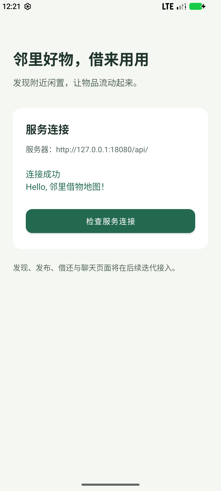

# 第 1 周记录

## 韩召然：2026-11-18

任务范围：Android / Spring Boot 工程骨架、数据库初始化和云端 Hello 部署。

### 已实现

- Android Java 17 + XML 工程，固定包名、统一 debug 签名、高德 Key 本地注入配置。
- Retrofit / OkHttp 网络基础、Token 拦截器接口、真实 Hello 连接检查页。
- Spring Boot 3 / Maven Wrapper / MyBatis / MySQL 工程，统一响应与异常处理。
- `/api/hello` 与检查数据库及六张表的 `/api/health`，契约已先更新。
- 生产配置模板、交互式部署脚本、systemd 单元、本地构建 / 打包 / 公网验收脚本。
- 云服务器已能通过 SSH 上传文件；数据库六张表、数据库用户创建和授权由韩召然的操作截图确认。

### 验证记录

| 检查 | 结果 |
| --- | --- |
| JDK 17 + Maven Wrapper 构建 | 通过，生成 `server/target/app.jar` |
| 服务端集成测试 | 4 项通过，覆盖 Hello、数据库检查、缺表失败、统一 404 |
| 可执行 JAR 的真实 HTTP 请求 | Hello 正常；数据库不可达时返回 50301 / HTTP 503；之后 Hello 仍正常 |
| Android APK 与网络测试 | 构建通过，2 项网络测试通过 |
| Android 模拟器实际联调 | 页面启动、点击检查连接后成功显示真实 JAR 的 Hello 响应；通过 ADB 转发连接本地服务 |
| Android Lint | 0 错误；HTTP 明文、固定工具版本及预留状态颜色存在已知警告 |
| APK 签名及包名 | 通过，包名与全组统一 debug SHA1 一致，最低 API 24 |
| 部署脚本与打包 | PowerShell / Bash 语法检查通过，ZIP 内只有 JAR、模板、脚本、服务单元和校验清单 |
| 云端部署与 MySQL 基础表检查 | 通过，韩召然执行部署脚本，Hello 成功，database / schema 均为 UP |
| 公网访问 | 通过，2026-11-18 从本机运行 Verify-Server.ps1，Hello 和 health 均为 PASS |
| systemd | 部署成功，已创建开机自启链接；未执行服务器重启测试 |

H2 自动测试只覆盖初始化检查逻辑，不能替代真实 MySQL 8 验收。
云服务器与数据库沿用此前已经准备的实例，不重新建表。
韩召然的第一周任务已完成；高德地图定位和底部导航等其他成员任务不据此标记完成。
服务地址通过成员本地配置同步，不在公共仓库记录实例 IP 或密码。
Gradle 8.13 分发包和 Wrapper JAR 的 SHA256 已与 [官方校验清单](https://gradle.org/release-checksums/)核对。
Maven 3.9.11 下载时校验了官方 SHA512，Wrapper 中也固定了分发包 SHA256。

Android 实际联调截图（显示本地开发地址）：

### 团队交接

- 方舒煜：使用 `android/README.md` 的包名和 SHA1 登记高德 Key，接入地图、定位、隐私授权。
- 隋骐泽：在已建立的 Android 工程中接入底部导航及各页面空壳；可替换 `ui/bootstrap` 入口。
- 注册登录、物品 CRUD 与图片上传属于第 2 周，不计入本次第 1 周完成范围。
