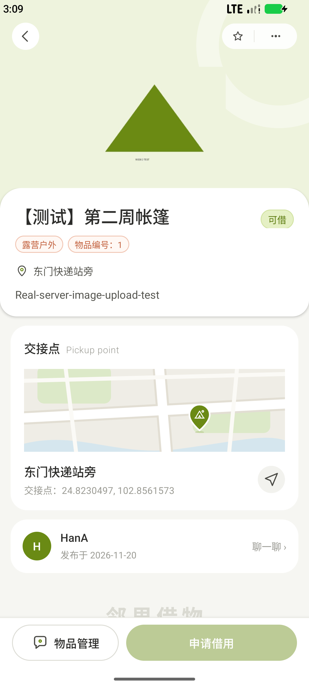
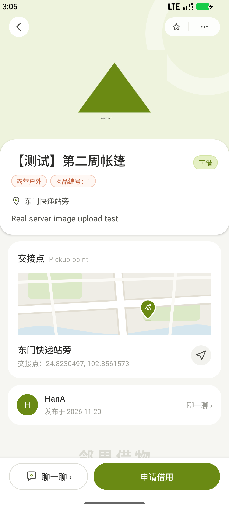
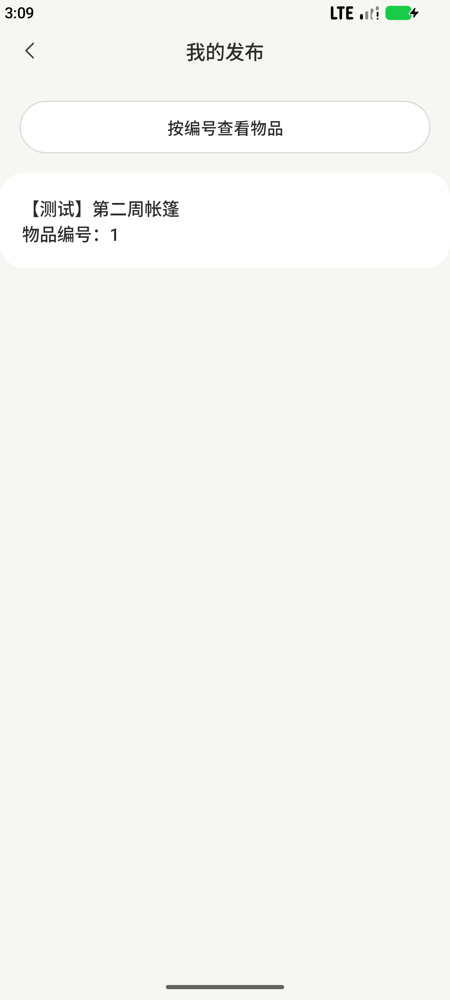
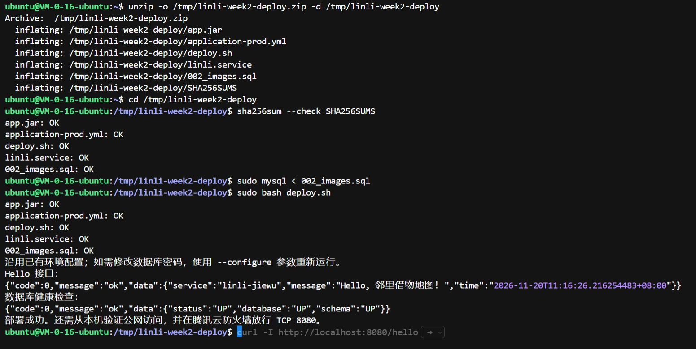

# 第 2 周记录

## 韩召然：2026-11-20

分支：`feature/hanzhaoran-week2-auth-items`，基于最新主线 `ed45c8c`（PR #5/#6 的界面版本）。

任务：真实注册登录、物品管理、图片上传及客户端联调。

### 已实现

- 账户：注册、登录、BCrypt 密码哈希、JWT 7 天有效期、本人资料读取/修改；重复用户名、无效 Token 与参数错误使用统一错误码。
- 图片：新增 `images` 表记录上传者、随机文件名及字节数；真实解码 JPG/PNG/WebP，限制文件大小和像素，重编码 PNG 去掉 EXIF；上传数据回滚时清理对应文件；引用图片需核对上传者。
- 物品：发布、公开详情、本人编辑/下架、我的发布分页；身份只从 Token 读取，修改物品先锁行；有进行中订单时禁止改交接点或下架。物主联系方式不在公开详情中返回。
- Android：沿用新版登录、发布和详情界面，替换对应模拟流程；保存 Token 和有效期，401 只清理被拒绝的旧会话；选图压缩、上传后发布，保存真实交接点经纬度，草稿按账户隔离。
- 我的发布：提供最小分页入口供本周验收，支持按编号打开另一账户的物品；物主通过详情管理菜单编辑或下架。
- 复用隋骐泽远端分支中的 `ImageCompressor`，补全镜像 EXIF 方向处理，未合并其整条功能分支，也未重做页面。
- 修正新版界面两处最低 API 24 的 Lint 错误：冗余字体权重移除，浅色导航栏属性按 API 27 拆分。
- 增量升级：`docs/migrations/002_images.sql` 只新增图片表；部署包包含该脚本，部署前检查图片表字段，原有数据保留。

### 本地验证

| 检查 | 结果 |
| --- | --- |
| 服务端 Maven verify | 12 项测试通过（4 项基础检查 + 8 项第 2 周集成测试），生成 `server/target/app.jar` |
| Android assembleDebug / testDebugUnitTest | 构建通过，6 项网络测试通过 |
| Android Lint | 0 错误，89 项警告（含既有界面可访问性、Overdraw、HTTP 等提示） |
| 最终远端 APK | `.artifacts/linli-week2-debug.apk` 按本机已有远端地址配置构建；v2 签名校验通过，SHA1 与全组 debug keystore 一致 |
| 独立 Android 模拟器 | 使用只读 AVD、`emulator-5556`，未在用户真机安装 |
| 真实注册/登录 | 账户 A/B 均通过界面注册；账户 A 退出后通过真实登录重新进入 |
| 真实图片与物品 | 系统选图 → 压缩 → POST /images → POST /items → 详情；物主编辑也通过界面验证 |
| 双账户验收 | 账户 B 通过“我的 → 按编号查看物品”读取账户 A 的同一物品编号 1、图片和交接点；实际 HTTP 越权编辑返回 40301 / HTTP 403 |
| 图片内容核对 | 服务端图片为 640×480 PNG，像素内容与测试封面相符；SHA256 为 `0a8bb006cfec92a32551528e0452c62da2cac91b96310d02301efff03d99eccb` |
| 脚本 | Bash 部署脚本语法、PowerShell 解析通过；部署 ZIP 已生成 |

本地测试使用 H2 测试库，不连接云端数据库。H2 不能替代 MySQL 8 的增量升级及公网验收。
实际 HTTP 验收结果保存在本机忽略目录 `.artifacts/week2-smoke-results.json`，不包含 Token 或密码。
图中交接点是模拟器虚拟定位，测试物品命名在验收整理时统一为“【测试】第二周帐篷”。

### 云端部署与公网验收（2026-11-20）

韩召然沿用第 1 周方式，在服务器终端执行增量 SQL 和部署；截图显示包内 SHA256 全部通过、`002_images.sql` 无报错，新服务 Hello 成功且 database/schema 均为 UP（约 11:16，Asia/Shanghai）。

随后从本机访问本地配置中的公网服务，11:20 完成以下 10 项检查，结果全部通过：

| 云端检查 | 结果 |
| --- | --- |
| 公网 Hello / health | 均成功，七张表可读 |
| 两个新测试账户注册、登录、本人资料 | 均成功，返回真实数据库用户 id；响应无密码哈希 |
| JPG 上传与公开 PNG 图片读取 | 成功，云端重新编码图片可读 |
| 账户 A 发布物品 | 成功，新物品编号 1，返回本人标记 |
| 账户 B 读取同一物品 | 编号、标题、图片地址和交接点一致，本人标记为 false；无物主联系方式 |
| 越权修改、越权下架、引用他人上传图片 | 均为 HTTP 403 / 40301 |
| 我的发布分页与未登录拦截 | A 有 1 条，B 为 0 条；未登录读本人资料返回 40101 |
| 物主编辑 | 成功 |
| 验收数据收尾 | 测试物品已下架，游客读取返回 40401；没有操作其他用户物品 |

公网测试使用真实部署和 MySQL，不是本地 H2。首次验证的一次新连接出现超时，随后复用连接完成整套公网业务检查；不把该次超时记为业务接口失败。
完整机器结果位于本机忽略目录 `.artifacts/week2-cloud-results.json`，不记录实例地址、密码或 Token；云端测试图片 SHA256 为 `baa61829aad7d9cfca0b17c787d2a37a8c8cf217b9f2737905ea950782505634`。

韩召然第 2 周代码、本地联调、云端升级和公网接口验收均已完成。最终 APK 已按相同公网服务地址构建；用户可安装后再做真机双账户演示。未执行服务器重启验收，也不据此标记其他成员任务或全组第 2 周完成。

### 后续范围

- 方舒煜：发现/浏览页的附近检索与真实列表数据，选点页的 POI 搜索及名称/坐标联动仍需继续完善。
- 隋骐泽：SQLite 草稿、借还与聊天页面后续接入；本周 SharedPreferences 草稿不是 SQLite 实现。
- 韩召然第 3 周：借用事务、requestId 幂等及状态操作接口；聊天和超时任务按第 4 周安排。
- 发现/浏览、借还、聊天目前仍有原型示例数据；真实物品详情不再回退到假数据。测试共享物品先走按编号入口。
- 本周保留未引用的上传文件，不自动清理，避免删除未来订单快照需要的图片。
