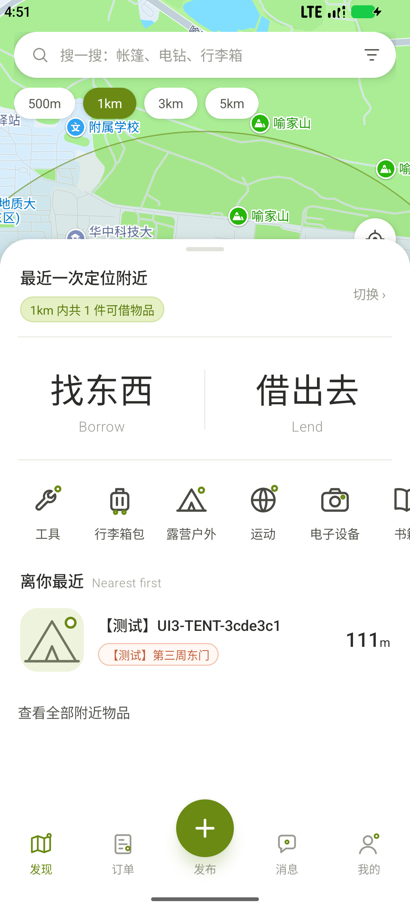
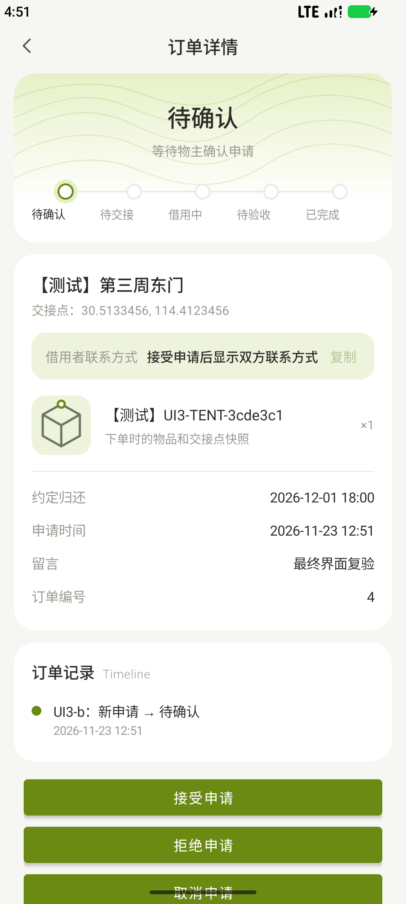
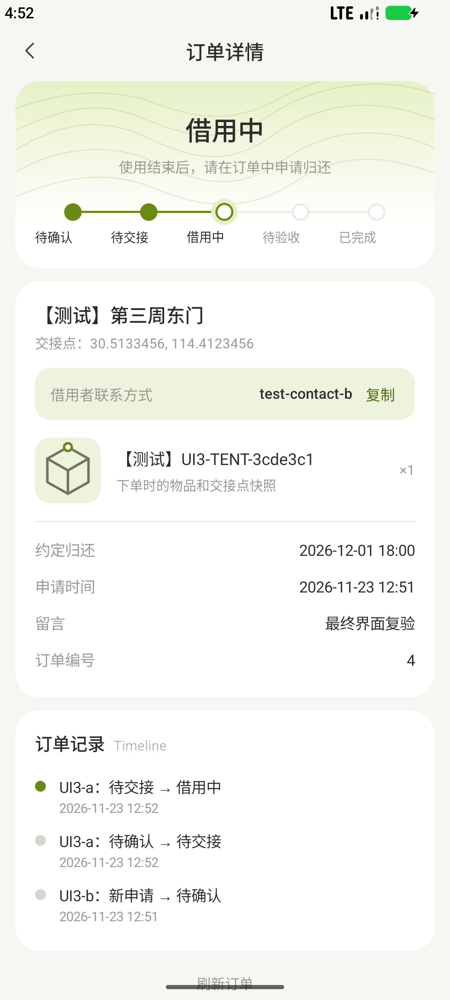
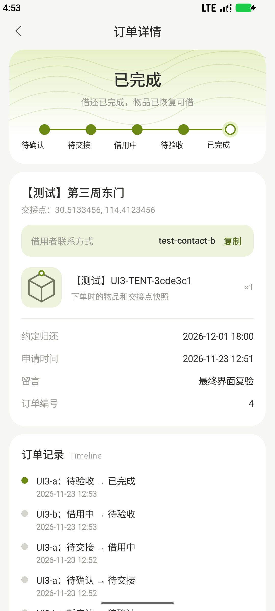

# 第 3 周记录

## 韩召然：2026-11-23

分支：`feature/hanzhaoran-week3-borrow`，基于主线 `64263bb`（已合并第 2 周 PR #7 和发现页角标修复 PR #8）。第三周借还功能整理为一个提交，通过 Pull Request 提交审查。

任务：真实附近检索与客户端借还全流程，包含申请事务、requestId 幂等、状态操作、订单查询、权限及联调。

### 已实现

- `POST /api/borrows`：校验首次申请归还时间、禁止借自己的物品、物品行锁、下单快照、12 小时 expiresAt、占用物品和初始日志在同一事务内完成。
- 幂等：按“借用者 + 规范化 requestId”查重，配合数据库唯一键；重复请求返回原订单当前详情。并发同号跨物品冲突在独立事务回滚后再读取赢家，失败方不留下物品占用。
- 查询：`GET /borrows` 支持借入/借出身份、状态组合与分页，按 id 降序；详情和升序日志只允许双方读取。物品标题、图片和交接点使用下单快照。
- 七个状态操作：accept、reject、cancel、handover、return、confirm-return、deny-return；固定先锁物品、后锁订单，校验来源状态、操作身份、物品状态和 active_borrow_id，状态变化恰好写一条日志。
- 归还未通过时回到 BORROWING、物品保持 LENT；拒绝、交接前取消及归还完成时释放物品。已结束旧订单不能释放后续新订单占用的物品。
- 联系方式仅在 ACCEPTED/BORROWING/RETURNING/COMPLETED 对双方可见；PENDING/CANCELLED、公开物品接口不暴露。逾期仅标记，不自动释放物品。
- accept 在锁内拒绝已过 expiresAt 的申请；第 4 周自动超时任务尚未实现。已有会话可关联到订单，无会话时 conversationId 为 null，聊天创建/推送由后续任务接入。
- 补齐 H2 借还表测试结构、将测试连接等待设为 15 秒；生产连接配置不变。JSON 接口收到不支持的 Content-Type 返回统一 40001，避免误报内部错误。
- 附近检索：数据库包围框粗筛与 Haversine 精确距离过滤，支持分类、字面关键词、状态和分页；处理跨日期变更线与极区。默认只显示可借物品，预约后移出、取消/归还后恢复。
- Android 首页/浏览改为真实列表与真实交接点标记；关键词 300ms 防抖、取消旧请求并校验请求序号，支持半径、分类、分页、加载/失败重试/空状态，无坐标时提示定位。
- Android 详情接通申请；申请发送前按账户/物品保存 requestId 与不可变请求，重试或页面重建沿用原号，成功进入真实订单编号。借入/借出、详情、日志、个人统计全部接接口，七种操作按钮按角色/状态显示，成功后重新读取服务端。
- 移除上述页面的示例物品/固定订单跳转、硬编码地点和虚构消息角标；修正申请/订单物品标题与顶栏重复 ID，状态提示及联系方式标签随真实状态/身份变化。聊天与 POI 仍按后续任务接入。

### 实现与验证

| 任务 | 验证 |
| --- | --- |
| 接口 v0.3、幂等范围与状态规则 | 与实现及客户端交接说明核对 |
| H2 首次连接、账户/物品/图片回归 | 原有 12 项测试通过 |
| 申请事务、快照、幂等、订单查询 | 4 项申请/查询测试、7 项并发/事务测试通过 |
| 状态机、权限、日志、时间和请求类型边界 | 9 项状态测试通过 |
| 附近检索及客户端真实接入 | 附近检索 6 项、客户端网络/规则 11 项通过，独立模拟器双账户完整借还通过 |
| HTTP 验收脚本、部署包和交接材料 | 真实 HTTP 36 项通过，脚本语法与包内 SHA256 校验通过 |

服务端实现、测试、验收脚本、部署支持及本记录随同一个功能提交交付。

### 本地验证

| 检查 | 结果 |
| --- | --- |
| Maven verify | 38 项测试，0 失败、0 错误；生成 `server/target/app.jar` |
| 原有回归 | 基础检查 4 项、第 2 周账户/物品/图片 8 项通过 |
| 借还申请/查询 | 4 项，包含快照、分页、隐私、参数及重复幂等号 |
| 借还状态 | 9 项，覆盖完整主流程、拒绝验收、双方取消、34 组非法来源状态、所有操作的身份校验、过期及日志失败回滚 |
| 并发/事务 | 7 项，包含抢借、同号跨物品、日志故障、重复接受、接受/取消、申请/下架、确认归还/再次申请竞争 |
| 附近检索 | 6 项，含 499/500/501 米、原始距离边界、日期变更线、极区、字面关键词、分类/状态、排序分页及预约可见性 |
| Android | assembleDebug、11 项网络/规则测试、Lint 0 错误（108 项警告）；最终 APK 按本机原有服务器配置构建，不包含临时联调坐标 |
| 真实 HTTP | 本机 `127.0.0.1:18080` 独立 H2 服务，`scripts/Verify-Week3.ps1` 36 项全部通过，涵盖附近检索可见性、两账户完整借还及再次归还流程 |
| 独立模拟器 | `Medium_Phone -read-only`、`emulator-5556`；真实登录 B→附近/关键词检索→申请→登录 A 接受/交接→B 申请归还→A 确认，物品恢复 AVAILABLE、5 条日志；最终界面再次核对标题、状态和按钮 |
| 脚本 | PowerShell 解析、Bash 部署脚本语法通过 |
| 部署包 | `.artifacts/linli-week3-deploy.zip`，含 JAR、模板、部署脚本、systemd、002_images.sql 和 SHA256SUMS；所有包内校验值核对通过 |

机器记录：`.logs/week3-fullflow-server.log`、`.logs/week3-preview-build.log`、`.logs/week3-fullflow-android.log`、`.artifacts/week3-http-results.json`、`.artifacts/week3-ui-results.json`（本机忽略目录）。结果不含密码、Token 或实例地址；本轮测试物品已下架。模拟器使用临时本地地址和固定调试坐标，不在用户真机安装。









### 本地复现与交接

在仓库根目录的 PowerShell 7：

```powershell
.\scripts\Build-Week1.ps1 -Component Server
.\scripts\Start-Week2-Smoke.ps1 -JavaHome '本机JDK17目录'
```

Start-Week2-Smoke 沿用已有脚本名，现可加载完整借还测试结构。启动后另开终端：

```powershell
.\scripts\Verify-Week3.ps1
.\scripts\Package-Server.ps1
```

客户端已按接口文档第 5、6 节接入；同一次提交的失败重试保留 requestId，显式重新填写才生成新编号。请求体不传用户身份；订单详情/列表的 item 使用快照。状态接口允许不带请求体，有请求体则使用 JSON。实际使用时需要同时部署本周服务端与安装新版 APK。

第 3 周无生产数据库结构增量，原始建表脚本已包含借还字段和唯一键；已完成第 2 周升级的环境无需额外迁移。部署脚本替换 JAR 前检查借还字段、唯一键和 InnoDB 引擎，不自动修改表或清库。

### 尚未执行与后续范围

- 本轮仅完成本地实现与验收，没有执行云端升级、真实 MySQL 多连接并发或公网业务验收。H2 通过不能替代这些检查；部署步骤见 `docs/部署说明.md`。
- 第 4 周：12 小时 PENDING 超时自动取消、聊天 REST 接口、会话创建关联与 WebSocket 推送。
- 隋骐泽：SQLite 草稿、搜索历史及聊天页面后续接入。
- 方舒煜：定位异常、POI 搜索、地图/搜索体验及后续性能测试。
